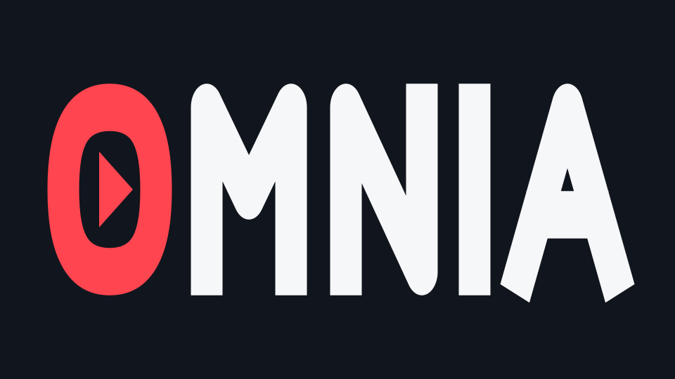

### Your next watch. Beautifully organized.

A cinema-inspired home for movies, shows, and your personal library. 
Made for the big screen. Ready for your phone.

[Add-ons](addons/README.md) · [Features](#explore-omnia) · [Downloads](#choose-your-device) · [Get started](#get-started) · [Release notes](https://github.com/Workedword/Omnia/releases)

---

## Explore Omnia

| Discover something great | Pick up where you left off |
| --- | --- |
| Artwork-rich movie and TV catalogs, title details, seasons, and episodes. Choose what belongs on your home screen. | Keep current titles close with **Continue Watching**, saved playback progress, and a personal library. |
| **Make it yours** | **Bring your sources** |
| A dark cinema layout with red accents, configurable home sections, and appearance preferences. Manage **Account & Profiles** together. | Install compatible catalog, stream, and subtitle add-ons. Manage playback providers in Connected Services. |
| **Settle in and watch** | **Built for your screen** |
| Play, pause, seek, choose available audio tracks, and adjust subtitle appearance and timing. | Remote navigation on Fire Stick and Android TV. Touch controls on Android phones and tablets, with an iPhone beta available. |

## Features at a glance

### 🎬 Discovery & home

- Movie and TV catalogs, artwork, title details, seasons, and episodes.
- Catalog selection and filtering under **Content & Discovery**.
- Configurable home rows and hero catalog selections.
- **Continue Watching** for titles in progress.

### 📚 Library & profiles

- Save movies and shows to your library.
- Keep track of watched titles and playback progress.
- Manage your Omnia account and profiles in one settings area.
- Account-based preferences and sync where enabled; account access is required.

### ▶️ Playback & subtitles

- Built-in playback with pause, resume, and seeking.
- Available audio-track and subtitle selection.
- Subtitle appearance and timing controls.
- Playback preferences for your device and source.

### 🧩 Catalogs, add-ons & providers

- Compatible catalog, stream, and subtitle add-ons.
- Browse Community Add-ons on TV, Android, and iPhone, including Torrentio, Comet, MediaFusion, IPTV, and sports setup links.
- Choose which catalog rows appear on your home screen.
- Manage add-ons and playback providers from settings.
- Connect supported services such as Real-Debrid using your own account and compatible source configuration.

### ✨ Designed around your device

- Dark, spacious presentation with Omnia's red accents.
- TV remote navigation and a separate mobile touch interface.
- Appearance and home-screen customization.
- In-app update checks on Android and TV, with separate platform downloads.

Feature availability varies by platform, source, and account configuration. iOS is currently beta.

---

## Choose your device

| | Fire Stick / Android TV | Android | iPhone |
| --- | --- | --- | --- |
| **Version** | 0.3.11 | 0.4.9 | 0.4.9 · Beta |
| **Designed for** | Your TV and remote | Phones and tablets | iPhone touch controls |
| **Package** | TV APK | Android APK | IPA |
| **Install** | Sideload the TV APK | Install the Android APK | Sign and sideload; iOS 16.1+ |
| **Download** | [Get TV app](https://github.com/Workedword/Omnia/releases/download/v0.3.11%2Btv/Omnia-TV-0.3.11.apk) | [Get Android app](https://github.com/Workedword/Omnia/releases/download/v0.4.9%2Bandroid/Omnia-Mobile-0.4.9.apk) | [Get iOS beta](https://github.com/Workedword/Omnia/releases/download/v0.4.9%2Bios/Omnia-iOS-0.4.9.ipa) |

## Get started

1. **Choose your device.** Download the matching app above.
2. **Install Omnia.** On iPhone, sign the IPA with your Apple account using a sideloading tool.
3. **Make it yours.** Choose catalogs, configure compatible sources, and adjust your preferences.
4. **Start exploring.** Browse titles, build your library, and pick your next watch.

## Good to know

<strong>How do I update?</strong>

Use Omnia's update checker on Android and TV, or install the matching APK over your existing app. Do not uninstall first. Your device may request installation approval and closes the app while applying the update. On iOS, sign and install updates through your sideloading tool.

<strong>Which package should I choose?</strong>

Choose the TV APK for Fire Stick or Android TV, the Android APK for phones and tablets, and the IPA for iPhone. APK files do not install on iOS. Each platform has its own version and release channel.

<strong>Does Omnia include movies or provider subscriptions?</strong>

Media availability comes from your configured sources. Provider subscriptions and accounts are separate from Omnia. Playback support depends on your device, source, and media format.

<strong>What should I know about the iPhone beta?</strong>

Requires iOS 16.1 or later and signing through a sideloading tool. The iPhone app is offered as a beta; feature support may vary by device and configured source.

---

**OMNIA · Your screen. Your library. Your next watch.**

[Platform guide](PLATFORMS.md) · [Releases](https://github.com/Workedword/Omnia/releases) · [Privacy](OMNIA-PRIVACY.md) · [Notices](OMNIA-NOTICES.md)

