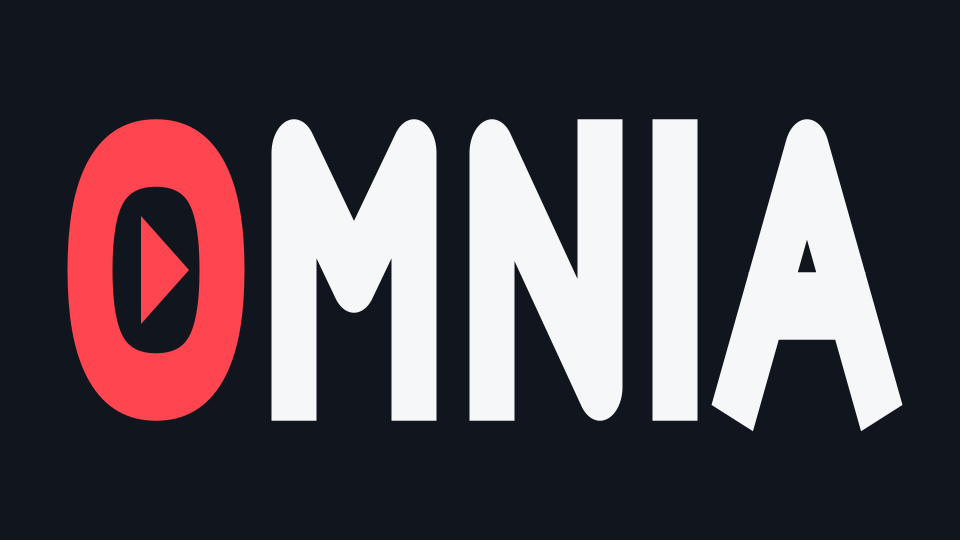

### Your next watch. Beautifully organized.

A cinema-inspired home for movies, shows, and your personal library. 
Made for the big screen. Ready for your phone.

[Discord](https://discord.gg/svMgchRA3f) · [Developers](#build-with-us) · [Contribute](CONTRIBUTING.md) · [Add-ons](addons/README.md) · [Features](#explore-omnia) · [Downloads](#choose-your-device) · [Get started](#get-started) · [Release notes](https://github.com/Workedword/Omnia/releases)

---

## Explore Omnia

| Discover something great | Pick up where you left off |
| --- | --- |
| Artwork-rich movie and TV catalogs, title details, seasons, and episodes. Choose what belongs on your home screen. | Keep current titles close with **Continue Watching**, saved playback progress, and a personal library. |
| **Make it yours** | **Bring your sources** |
| A dark cinema layout with red accents, configurable home sections, and appearance preferences. Manage **Account & Profiles** together. | Install compatible catalog, stream, and subtitle add-ons. Manage playback providers in Connected Services. |
| **Settle in and watch** | **Built for your screen** |
| Play, pause, seek, choose available audio tracks, and adjust subtitle appearance and timing. | Remote navigation on Fire Stick and Android TV. Touch controls on Android phones and tablets, with an iPhone beta available. |

## Features at a glance

### 🎬 Discovery & home

- Movie and TV catalogs, artwork, title details, seasons, and episodes.
- Main cast names beneath director credits when supplied by the catalog.
- Home catalog choices and Collections together under **Settings → Content** on TV, Android and the current iOS beta.
- Configurable home rows and up to 12 hero catalog selections on Android and TV.
- Search followed by inline Discover filters on TV.
- Collections can hide their source rows from Home to avoid duplicates.
- **Continue Watching** for titles in progress.

### 📚 Library & profiles

- Save movies and shows to your library.
- Keep track of watched titles and playback progress.
- Manage your Omnia account and profiles in one settings area.
- Optional **Sync settings across devices**; keep it off for separate device preferences.
- Sign in with your email and Omnia password. Create an account or reset your password from the sign-in screen.
- Use the same Omnia account across your devices to keep your profiles and viewing progress together.

### ▶️ Playback & subtitles

- Built-in playback with pause, resume, and seeking.
- Available audio-track and subtitle selection.
- Subtitle appearance and timing controls.
- Playback preferences for your device and source.

### 🧩 Catalogs, add-ons & providers

- Compatible catalog, stream, and subtitle add-ons.
- Browse compatible community catalogs, providers, and live TV/sports setup links.
- Four dedicated Add-ons pages: **Current Add-ons**, **Discover Add-ons**, **Sync Add-ons** and **Script Providers**.
- Installed HTTP add-ons leave the available list and remain in Current Add-ons. Filter new sources by **Omnia Official** or **Community**.
- Use **Sync add-ons** in compatible current apps, with progress and clear results.
- Choose which catalog rows appear on your home screen.
- Manage add-ons and playback providers from settings.
- Connect supported services such as Real-Debrid using your own account and compatible source configuration.

### ✨ Designed around your device

- Dark, spacious presentation with Omnia's red accents.
- TV remote navigation and a separate mobile touch interface.
- Appearance and home-screen customization.
- **Restore default settings** is available directly in Settings. Confirmation keeps account and media data intact.
- In-app update checks on Android and TV, with separate platform downloads.
- Bounded artwork/network caches and automatic cleanup of obsolete update installers on Android and TV.

Feature availability varies by platform, source, and account configuration. The iPhone beta includes the mobile interface, account sign-in, updated settings and add-on sync. Cross-device settings sharing requires compatible app versions.

---

## Choose your device

| | Fire Stick / Android TV | Android | iPhone |
| --- | --- | --- | --- |
| **Version** | 0.3.26 | 0.4.24 | 0.4.24 · Beta |
| **Designed for** | Your TV and remote | Phones and tablets | iPhone touch controls |
| **Package** | TV APK | Android APK | IPA |
| **Install** | Sideload the TV APK | Install the Android APK | Sign and sideload; iOS 16.1+ |
| **Download** | [Get TV app](https://github.com/Workedword/Omnia/releases/download/v0.3.26%2Btv/Omnia-TV-0.3.26.apk) | [Get Android app](https://github.com/Workedword/Omnia/releases/download/v0.4.24%2Bandroid/Omnia-Mobile-0.4.24.apk) | [Get iOS beta](https://github.com/Workedword/Omnia/releases/download/v0.4.24%2Bios/Omnia-iOS-0.4.24.ipa) |

## Get started

1. **Choose your device.** Download the matching app above.
2. **Install Omnia.** On iPhone, sign the IPA with your Apple account using a sideloading tool.
3. **Sign in to Omnia.** Use your email and Omnia password. Choose the same account and profile on your other devices. Use **Forgot password** if you need to set or reset your password.
4. **Make it yours.** Choose catalogs, configure compatible sources, and adjust your preferences.
5. **Start exploring.** Browse titles, build your library, and pick your next watch.

## Good to know

<strong>How do I update?</strong>

Use Omnia's update checker on Android and TV, or install the matching APK over your existing app. Do not uninstall first. Your device may request installation approval and closes the app while applying the update. On iOS, sign and install updates through your sideloading tool.

<strong>Which package should I choose?</strong>

Choose the TV APK for Fire Stick or Android TV, the Android APK for phones and tablets, and the IPA for iPhone. APK files do not install on iOS. Each platform has its own version and release channel.

<strong>Does Omnia include movies or provider subscriptions?</strong>

Media availability comes from your configured sources. Provider subscriptions and accounts are separate from Omnia. Playback support depends on your device, source, and media format.

<strong>What should I know about the iPhone beta?</strong>

Bring Omnia’s mobile interface to your iPhone with iOS 16.1 or later. Sign and install the IPA through your preferred sideloading tool. This is a beta, so compatibility and performance can vary. Apple silicon Mac compatibility is experimental; the download is an iPhone IPA.

## Build with us

Omnia welcomes bug fixes, accessible interface improvements, translations, tests and documentation. Start with the platform you use, then open a focused pull request.

| Area | Source | Start here |
| --- | --- | --- |
| Fire TV / Android TV | [`apps/tv`](apps/tv) | [TV build guide](docs/BUILD-TV.md) |
| Android and iOS | [`apps/mobile`](apps/mobile) | [Mobile build guide](docs/BUILD-MOBILE.md) |
| Community add-ons | [`addons`](addons) | [Add-on directory](addons/README.md) |
| Developer documentation | [`docs`](docs) | [Project structure](docs/PROJECT-STRUCTURE.md) |

The source baseline is TV **0.3.26** and shared mobile **0.4.24**. The exact iOS release inputs and instructions are also available in the [iOS 0.4.24 source archive](https://github.com/Workedword/Omnia/releases/download/v0.4.24%2Bios/Omnia-iOS-0.4.24-source.zip). Each client keeps its own Gradle project and platform settings.

[Contributing](CONTRIBUTING.md) · [Security reports](SECURITY.md) · [Project structure](docs/PROJECT-STRUCTURE.md) · [License and notices](OMNIA-NOTICES.md)

Download a release to use Omnia, or clone this repository to help develop it. Account and Discord services are operated separately; production access is not needed to contribute to the clients.

## Contact

Join [Omnia Streams on Discord](https://discord.gg/svMgchRA3f) for community discussion, support and release updates.

Omnia support: [omniastreams@gmail.com](mailto:omniastreams@gmail.com).

Please keep passwords, verification codes and private provider keys out of support messages.

---

**OMNIA · Your screen. Your library. Your next watch.**

[Platform guide](PLATFORMS.md) · [Releases](https://github.com/Workedword/Omnia/releases) · [Privacy](OMNIA-PRIVACY.md) · [Notices](OMNIA-NOTICES.md)

